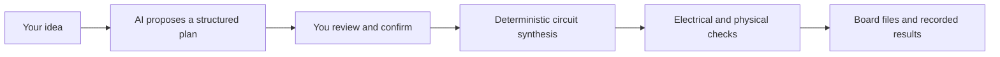

# Ohmni judge Q&A and independent demo acceptance

Prepared on 2026-10-13 America/Los_Angeles against fetched main
`db985333dff91cdab20fd50fca42e693347cf5e0`.

This is a documentation and read-only review deliverable. Claude owns the
implementation in [the overnight brief](OVERNIGHT_DEVELOPMENT_BRIEF.md), including
its final 180-second walkthrough and results. This document supplies questions,
evidence boundaries and independent checks for that handoff. It does not approve
another product task, change the ledger, or certify Claude's unfinished branch.

## The story to tell

**Ohmni helps a beginner turn a supported electronics idea into an inspectable
circuit, with recorded checks and an explanation of what still needs testing.**

For this demonstration, distinguish four things:



This diagram describes the confirmed-project path. It is not a claim that every
requested design is supported or every run reaches export. SPICE is a separate,
conditional check: an unresolved binding prevents whole-circuit simulation.

Lead with the user outcome, then show one exact artifact and its report. If the
fault demonstration passes acceptance, its strongest moment is the observable
change from a checked original to a damaged copy with a real DRC finding, followed
by restoration of the original. An attractive 3D model alone proves neither
electrical correctness nor manufacture readiness.

## Judge questions and defensible answers

The code anchors below are valid at the baseline commit. They describe implemented
paths, not fresh qualification of the presentation board.

| Question | Answer to rehearse | Code or recorded evidence |
|---|---|---|
| What does the AI actually do? | It turns the conversation into a structured proposal. The user confirms the plan, then deterministic synthesis builds the supported circuit. The AI cannot grant a verification pass. | `src/ohmni/application/conversation.py:92`, `:147`; `src/ohmni/application/projects.py:171` |
| Is this just one fixed board? | The confirmed-project path generates configurations within three supported families: USB-powered ESP32 sensors, buttons/lights, and SPI memory. The landing-page circuit and saved reference are separately identified examples. | `src/ohmni/synthesis/models.py:19`; `src/ohmni/application/projects.py:172`; `apps/web/index.html:39`, `:141`, `:147` |
| Can I ask for any electronic device? | The current product has a bounded design envelope. Unsupported functions need clarification or refusal. Accepted dimensions still need placement and routing checks. | `src/ohmni/application/conversation.py:96`; `src/ohmni/synthesis/base.py:54`; `src/ohmni/synthesis/models.py:73` |
| How do you prevent hallucinated engineering claims? | Typed proposals pass through deterministic checks. Reports keep failed, incomplete and unsupported checks distinct. A model's explanation does not replace those results. | `src/ohmni/application/projects.py:180`; `src/ohmni/verifier/engine.py:77`; `src/ohmni/application/demo.py:538` |
| Does SPICE prove the complete board works? | No. Simulation needs supported bindings for the entire circuit. If one is unresolved, the circuit simulation is refused. Even a supported simulation is a model result, not a bench measurement. | `src/ohmni/application/component_behavior.py:281`, `:299`, `:311`; `src/ohmni/application/demo.py:447` |
| What does KiCad add? | Its ERC and DRC independently check generated schematic and PCB artifacts. Export requires current artifact lineage and the specified routing/manufacturing gates. Show the exact receipts for the selected board. | `src/ohmni/application/projects.py:187`; `src/ohmni/manufacturing/exporter.py:35`, `:55`, `:61` |
| Could I order and use this board today? | The output is for human manufacturing review. The demonstration does not establish assembly, firmware behavior, bench operation, thermal performance, EMC, RF or signal integrity. The example fabrication profile is synthetic. | `src/ohmni/application/demo.py:413`, `:548`, `:579` |
| Are the costs live supplier quotes? | No. The current BOM service uses synthetic offers. Partial cost coverage does not establish the total build cost or stock availability. | `src/ohmni/bom/service.py:21`; `src/ohmni/bom/models.py:65` |
| Are all facts datasheet-verified? | Facts retain their evidence status. A catalog citation and a machine-checked PDF excerpt are different forms of evidence; source relocation and semantic support must pass before the latter is marked verified. | `src/ohmni/domain/evidence.py:274`; `src/ohmni/datasheet/verify.py:96` |
| Is this live or recorded? | Say which it is before showing the result. A saved board retains its original capture and limitations. A fresh run needs new receipts. Provider health alone does not establish that the current prompt was successfully interpreted. | `apps/web/reference-preview.js:34`; `.ai/verification/LP-CONTROLLER-PUBLISH.yaml:118`; `.ai/verification/CUX-T05.yaml:57` |

Three phrases to replace in slides or spoken narration:

- “Design any device” becomes “design within these supported families.”
- “Every electrical decision is verified” becomes “the report shows exactly what
  was checked and what remains unknown.”
- “A proven working product” becomes “generated files ready for manufacturing
  review, with hardware testing still required.”

The README's opening and feature copy includes broader phrases about universal
verification and automatic transient simulation (`README.md:5`, `:15`). Do not use
that prose as the evidence for a stage claim. This review does not edit it.

Sentry remains a proposed integration in `SENTRY_IMPLEMENTATION_PLAN.md:3`, `:18`.
Do not describe Sentry tracing, replay or sponsor-specific results as delivered
unless a later implementation and actual account evidence establish them. The
overnight demo task deliberately excludes that integration.

## Read-only browser observations

Observed on `https://ohmni-yvnd.vercel.app/` in the Codex in-app browser during this
review. The deployed commit was not identified, and the existing browser profile
was not a clean first-user context. These observations do not establish full
accessibility, mobile behavior, live AI operation or an offline pass.

| Observation | What it establishes | What to do for rehearsal |
|---|---|---|
| A previously open tab showed an older workbench; refreshing the landing tab loaded the current sidebar/workspace | Long-lived tabs can leave the presenter looking at an old interface | Open a fresh rehearsal tab after deployment; confirm the expected interface before presenting |
| Start building → Buttons and lights opened an editable plan; Back to your idea returned to the entry screen and focused its heading | This specific forward/back path worked without starting a build | Repeat on the actual presenter browser; test keyboard and mobile separately |
| Buttons and lights proposed two buttons, one LED and an included programming connector | The normal shortcut is not Claude's initial one-button/no-header qualification candidate | Use the exact final qualified brief from `OVERNIGHT_RESULTS.md`; do not silently substitute the shortcut |
| Explore a finished example opened a control labeled “Or run the fixed reference example” | This visible entry point is a run-oriented flow, not proof of an offline saved preview | Rehearse the explicit local saved-demo command delivered by phase 3 |

Source corroboration for the last two rows: `apps/web/app.js:108`, `:1360`;
`apps/web/index.html:140`; `apps/web/app.js:1355`, `:316`. The latter path reads
backend health and posts to `/api/brief`. A separate saved-preview implementation
exists, but `.workspace-examples` is hidden on the entry screen by
`apps/web/guided-flow.css:593`. These are baseline observations for phase 3, not
an assertion that the new offline implementation is broken.

No AI planning, generation, save, deployment, quota mutation or paid request was
initiated during this browser inspection. Existing saved projects were not edited.

## Independent acceptance after Claude finishes

All rows below start **NOT_RUN against Claude's final branch**. Do not copy the
browser observations above into these result cells. Freeze the candidate commit,
tool versions and environment first. Record each result against that candidate.

Use a disposable local/CI environment with fake providers for failure injection.
Do not exhaust production quotas, break production files or spend API credits to
test recovery. A separately authorized live rehearsal is needed for live claims.

| ID | Action or challenge | Required observation | Evidence to retain |
|---|---|---|---|
| D01 | Start a fresh presenter session; use the documented entry path | Exact brief, dimensions, counts and programming option match the qualified candidate; no accidental shortcut substitution | Normalized brief/hash and screenshot |
| D02 | Run the fresh engineering command three times sequentially | Actual semantic verification, physical placement checks, ERC, DRC, routing, manufacturing checks and required exports run each time; warnings and limitations retained | Commands, versions, durations, receipt and output hashes |
| D03 | Make KiCad unavailable in a disposable environment | The mandatory real-tool gate fails clearly; no passing or silently skipped qualification | Nonzero result and missing-tool diagnostic |
| D04 | Select the intentionally damaged copy | A real DRC error/unconnected finding belongs to that copy; visualization, selection and checker use the same artifact | Good/bad hashes, checker receipt and matching view |
| D05 | Change diagnostic bytes after their receipt was produced | Stale evidence is refused; it cannot retain the original green verdict or release | Failing freshness test and unchanged original release hash |
| D06 | Show fault → restore original three times; deliver a late old response | Original view/report/downloads return each time; an old response cannot replace the current selection | Browser/contract result with artifact identities |
| D07 | Use every visible Back action; recover from a simulated planning failure | Appropriate prior screen, preserved input, usable next action and sensible focus; no unexpected build starts | Browser steps and observations |
| D08 | Navigate with keyboard; inspect at 200% zoom and a narrow mobile viewport | All primary actions reachable and labeled; focus visible; errors conveyed in text; dialog Escape/focus return works; no hidden essential controls | Actual browser/viewport notes; separate untested cases |
| D09 | Load the saved demo in a fresh context with external network denied | Board, report and advertised downloads work locally; recorded status is explicit | Network log and downloaded-file hashes |
| D10 | Exceed limits with fake providers across every billed route | Rejected calls never reach the provider; 429/retry recovery preserves input; no automatic retry storm | Route matrix and call counters |
| D11 | Race admissions; return from an async handler while its worker continues; restart the service | Global admissions remain bounded and durable; concurrency lease remains held until provider work ends; failed admitted calls consume the documented count | Concurrency/restart tests and configured limits |
| D12 | Inspect downloads and presenter wording | Files match the original qualified board; no damaged release, fabricated price, unsupported simulation or live/recorded ambiguity | Release manifest and final spoken claims |

Also inspect the **final diff**, not only passing test names: assertions must
exercise real tools where claimed, fixtures must not replace the behavior being
tested, and UI receipts must remain tied to their source artifacts. Record skips
and missing environment dependencies explicitly.

### Presentation decision

- **Live AI-to-board demonstration:** use only after the candidate's relevant
  gates and the actual authorized live prompt rehearsal pass. Set a rehearsed
  switch point to the saved capture instead of waiting indefinitely on stage.
- **Fresh engineering demonstration:** a confirmed structured brief can start a
  real engineering run without a model call. Qualify and time that path; explain
  that the plan was already prepared, rather than claiming live AI interpretation.
- **Saved engineering demonstration:** appropriate when its original receipts,
  local assets and downloads pass inspection. Say it is a previously completed
  run. Live planning can be omitted without pretending it occurred.
- **Viewer-only reference:** appropriate when the available evidence establishes
  only a reference visualization. Do not narrate unperformed engineering checks.

Do not present the fault sequence if D04–D06 are unverified. A stale-file rejection
does not count as demonstrating KiCad detecting a physical design fault. A failing
live dependency need not spoil the presentation if the recorded fallback itself
has been tested and clearly labeled.

## Review record template

Append real results in Claude's handoff or a subsequent independent-review record;
do not mark this template as completed evidence.

```text
Candidate commit:
Reviewer and environment:
Tool versions:
Actual qualified brief and fingerprint:
Selected mode: live AI-to-board / fresh engineering / saved engineering / viewer-only
D01-D12 results: PASS / FAIL / NOT_RUN, each with evidence
Open blocking findings and affected presentation steps:
Unperformed live, hardware or deployment checks:
Exact safe entry/reproduction command:
```

Claude remains responsible for its implementation branch and ledger. Findings
from this pack should be reconciled against its finished code before fixes or
status changes are proposed. This document makes no independent approval or
completion claim for that work.
